# AVAMissile

A recreation of Atari's 1980 arcade game **Missile Command**, built with .NET 10 and Avalonia UI. Six
cities, three missile bases, and the sky full of warheads. Put the crosshair in their path and fire: each
counter-missile bursts into a fireball that destroys anything that flies into it. Bombers and killer
satellites drop more, warheads split as they fall, and smart bombs dodge your fireballs. Every wave is
faster than the last. In the end, all is lost: there is no winner.

## Features

- **Three bases, six cities**: ALPHA, DELTA and OMEGA each have ten missiles a wave, stacked on their
  mounds. The centre base, DELTA, fires much faster than the other two.
- **Fireballs and chain reactions**: a counter-missile bursts where it was aimed, swells, holds and shrinks
  away, flickering through colours. Anything inside it goes up in a fireball of its own, so one good shot
  can take out a whole salvo.
- **The attack**: warheads in salvos from the top of the sky; from the second wave, warheads that split
  partway down like MIRVs, and bombers or killer satellites crossing the sky dropping more; from the sixth,
  smart bombs that swerve round your fireballs.
- **The cabinet's rules**: each wave goes after at most three of the cities, plus the bases; points
  multiply every two waves up to 6×; each wave ends with a bonus for every unused missile and every city
  left; a bonus city every 10,000 points rebuilds a lost one.
- **New colours every two waves**, as on the cabinet: the sky, the ground, the cities and the trails all
  change.
- **THE END**: when the last city falls, an octagonal blast fills the screen. Not "game over": *the end*.
- **Mouse, keyboard or gamepad**: the mouse moves the crosshair like the trackball, and its three
  buttons fire from the three bases; or use the keys or a stick and three fire buttons.
- **Synthesised sound**: launches, the crunchy boom of the fireballs, cities going up, the siren before
  each wave, the tally's ticks and chimes, and the drone of bombers and satellites.
- **Attract mode**: leave the title screen alone for 20 seconds and a computer player defends the
  cities in a silent demonstration.
- **Top-ten high-score table** with arcade-style initials entry.
- **Any window size**: the 4:3 screen scales to fit, letterboxed. **Ctrl+S** saves a screenshot.
- **One self-contained executable** per platform: Windows, macOS and Linux on Intel/AMD and ARM.

## Screenshots

| Title screen | Defend the cities | Under attack |
|:------------:|:-----------------:|:------------:|
| 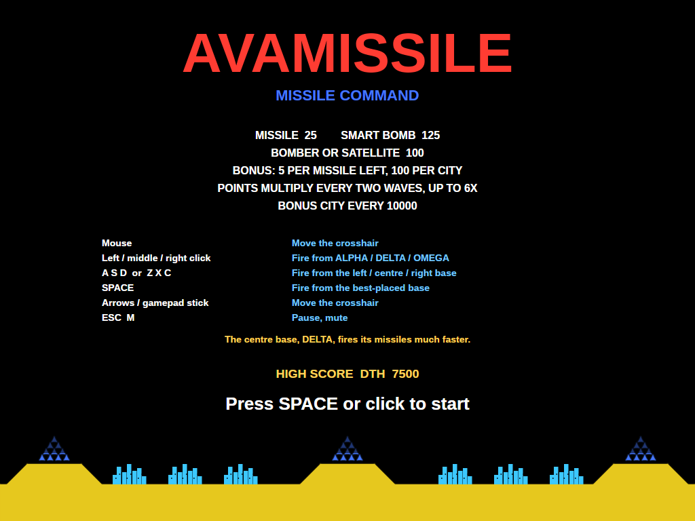 | 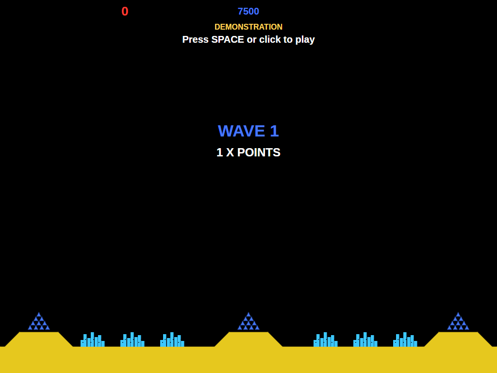 | 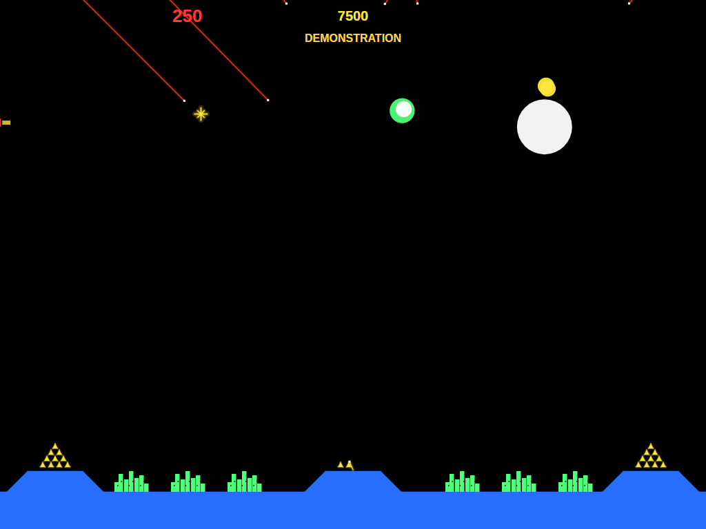 |
| The rules and the controls, over the cities. | The start of a wave, with its points multiplier. | Warheads coming down, fireballs going up. |

| Bombers | Killer satellites and smart bombs | New colours |
|:-------:|:---------------------------------:|:-----------:|
| 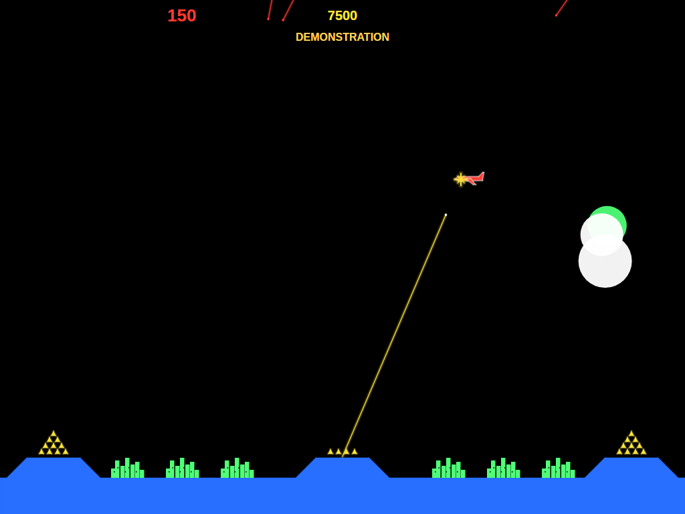 | 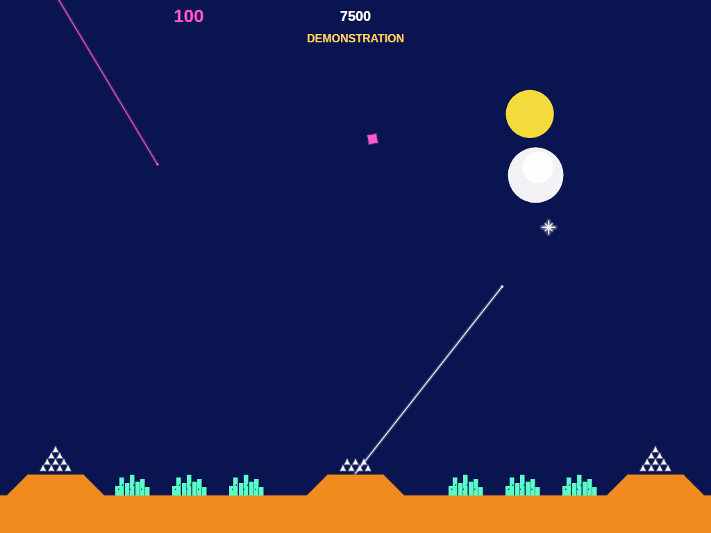 | 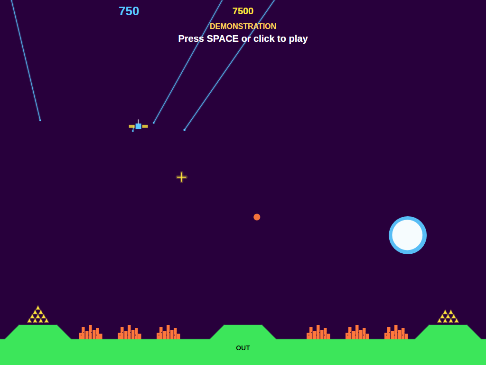 |
| A bomber crosses the sky, caught by a counter-missile. | The pink diamond is a smart bomb, swerving round the fireballs. | Every two waves the colours change; DELTA is out of missiles. |

| A crowded sky | The bonus | THE END |
|:-------------:|:---------:|:-------:|
| 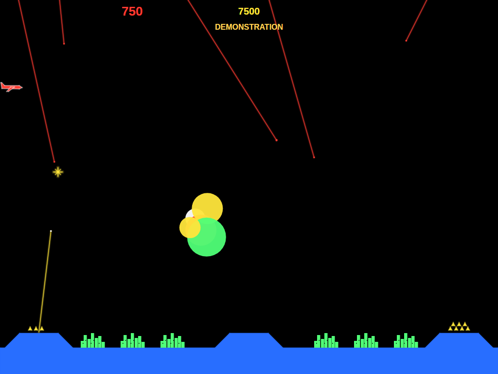 | 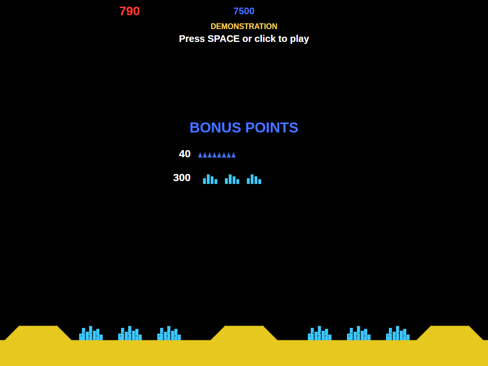 | 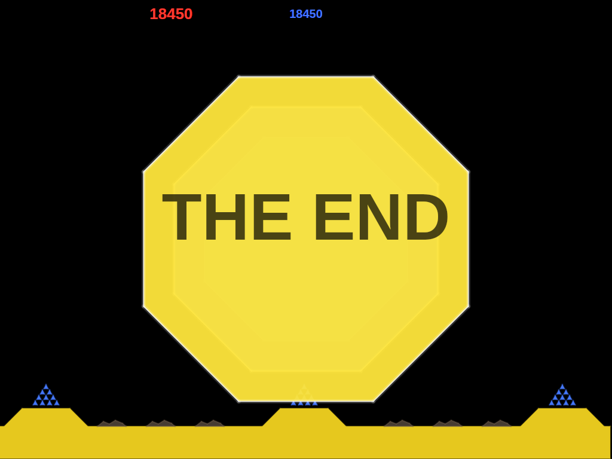 |
| Warheads from all over the sky, a bomber, and two bases running low. | Unused missiles and surviving cities, counted up. | The last city is gone. |

| Entering initials | The high-score table |
|:-----------------:|:--------------------:|
| 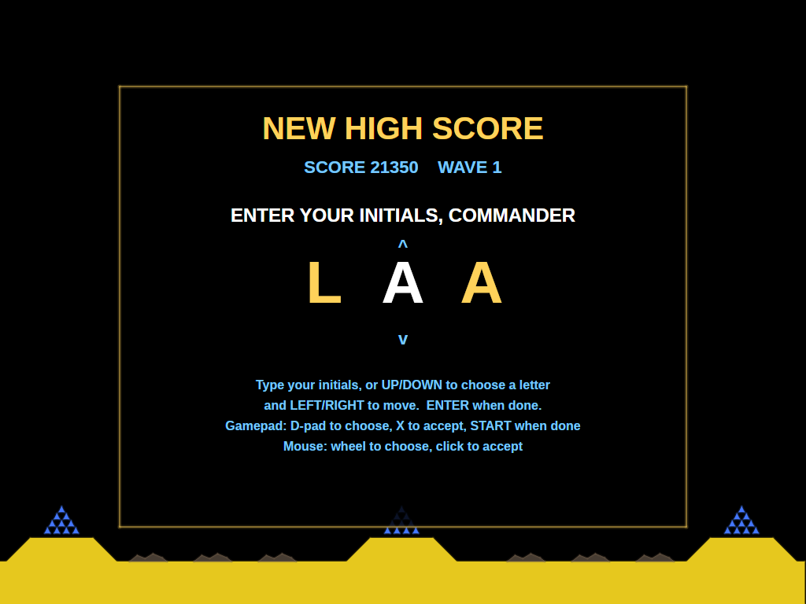 | 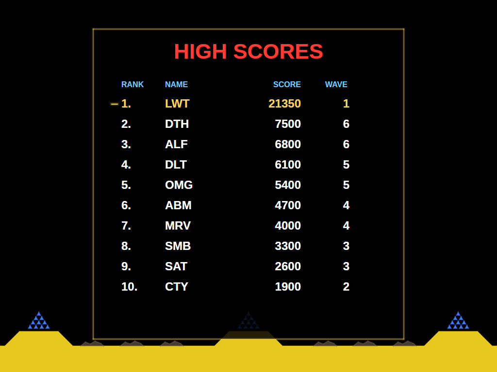 |
| A score that makes the top ten earns three initials. | The new entry flashes in the table. |

## Download and run

Ready-to-run builds for Windows, macOS and Linux, on both Intel/AMD and ARM, are on the
[Releases page](https://github.com/Harlock123/AVAMissile/releases). **Latest build** is rebuilt on every
push to `main`. Each download is one self-contained executable: no .NET install is needed.

```bash
tar -xzf AVAMissile-linux-arm64.tar.gz     # or linux-x64, linux-arm, osx-arm64, osx-x64
./AVAMissile
```

On Windows, unzip `AVAMissile-win-x64.zip` (or `-win-arm64`, `-win-x86`) and run `AVAMissile.exe`. On
macOS, if Gatekeeper refuses to open it, run `xattr -d com.apple.quarantine AVAMissile` once.

### Linux: sound and gamepads

- **Sound** needs `aplay`, from the `alsa-utils` package. Without it the game runs but is
  silent. Minimal installs (Arch, Omarchy, some Raspberry Pi images) don't include it:

  ```bash
  sudo apt install alsa-utils             # Debian / Ubuntu / Raspberry Pi OS
  sudo pacman -S --needed alsa-utils      # Arch / Omarchy
  ```

- **Gamepads** use SDL2. It is bundled for Windows, macOS and Intel/AMD Linux, but **ARM Linux builds need it
  installed**. Without it the keyboard and mouse still work; only the controller does not:

  ```bash
  sudo apt install libsdl2-dev            # Debian / Ubuntu / Raspberry Pi OS
  sudo pacman -S --needed sdl2-compat     # Arch / Omarchy
  ```

  On Debian-based systems it has to be `libsdl2-dev`: the game looks for `libSDL2.so`, which
  the runtime-only `libsdl2-2.0-0` package doesn't provide.

## Requirements

- .NET 10 SDK (to build; the released executables need nothing)
- Windows, macOS or Linux

## Building and Running

```bash
cd AVAMISSILE
dotnet build
dotnet run
```

## Controls

The cabinet had a trackball for the crosshair and three fire buttons, one for each base.

### Mouse

| Input | Action |
|-------|--------|
| **Move** | Move the crosshair |
| **Left Button** | Fire from ALPHA (left base) |
| **Middle Button** | Fire from DELTA (centre base) |
| **Right Button** | Fire from OMEGA (right base) |

The pointer is hidden while you play: the crosshair is the pointer.

### Keyboard

| Key | Action |
|-----|--------|
| **Arrows** | Move the crosshair |
| **A** / **Z** | Fire from ALPHA (left) |
| **S** / **X** | Fire from DELTA (centre) |
| **D** / **C** | Fire from OMEGA (right) |
| **Space** / **Ctrl** | Fire from whichever base will get there first |
| **Esc** | Pause (Esc again to quit) |
| **M** | Mute all sound |

### Controller (Xbox/PlayStation/Switch Pro)

| Input | Action |
|-------|--------|
| **Left Stick** / **D-Pad** | Move the crosshair |
| **X** / **Left Bumper** | Fire from ALPHA |
| **A** / **Y** | Fire from DELTA |
| **B** / **Right Bumper** | Fire from OMEGA |
| **Triggers** | Fire from whichever base will get there first |
| **Start** | Pause / Resume game |
| **Back/Select** (while paused) | Exit game |

### Entering initials

| Key | Action |
|-----|--------|
| **A**–**Z**, **0**–**9**, **.** | Type a letter and move to the next |
| **Up** / **Down** | Dial the current letter |
| **Left** / **Backspace**, **Right** | Move between letters |
| **Space** | Accept the letter |
| **Enter** | Done |

Gamepad: D-pad dials and moves, **X** accepts, **Start** finishes. Mouse: the wheel dials, a click accepts.

### Other

| Key | Action |
|-----|--------|
| **Ctrl+S** / **Cmd+S** | Save screenshot to Pictures folder |

## Gameplay

### Firing

Each shot flies from its base to the point the crosshair was on when you fired, marked with an X, and
bursts there. The fireball takes a moment to swell, so aim where a warhead is *going* to be, not where it
is. The side bases' missiles are slow; DELTA's are twice as fast, so save them for the urgent shots and
the smart bombs. A base with three missiles left shows **LOW**; with none, **OUT**.

### The attack

| Threat | From wave | Behaviour |
|--------|-----------|-----------|
| **Warhead** | 1 | Falls in a straight line toward a city or a base, trailing smoke |
| **MIRV** | 2 | A warhead that splits into two or three partway down |
| **Bomber** / **killer satellite** | 2 | Crosses the sky, dropping warheads as it goes |
| **Smart bomb** | 6 | A diamond that swerves round your fireballs |

A city or base hit is destroyed. Destroyed bases come back, restocked, for the next wave; destroyed cities
stay down unless a bonus city rebuilds them.

### Waves

Each wave starts with a siren and a reminder of the points multiplier, then the attack, then the bonus: 5
points for every missile left in a base and 100 for every city standing, both multiplied. Every 10,000
points earns a bonus city, put up after a wave in place of one that's been lost. The game ends when no
city is left: THE END.

## Scoring

| Target | Points (× the wave's multiplier) |
|--------|----------------------------------|
| Warhead | 25 |
| Bomber or killer satellite | 100 |
| Smart bomb | 125 |
| Unused missile, at the end of a wave | 5 |
| City standing, at the end of a wave | 100 |

The multiplier is 1× for waves 1 and 2, 2× for waves 3 and 4, and so on up to 6× from wave 11.

## Sound Effects

All effects are synthesised by `tools/make_sounds.py`; nothing is sampled from the original machine.

| Sound | When |
|-------|------|
| `Launch.wav` | A counter-missile launched |
| `Boom.wav` | A fireball |
| `CityBoom.wav`, `BaseBoom.wav`, `FlyerBoom.wav` | A city, a base, or a bomber or satellite destroyed |
| `Alert.wav` | The siren before each wave |
| `Low.wav`, `Empty.wav` | A base running low, or firing from an empty one |
| `TallyMissile.wav`, `TallyCity.wav` | The bonus counted up |
| `BonusCity.wav` | A bonus city rebuilt |
| `Flyer.wav`, `SmartBomb.wav` | A bomber or satellite crossing, a smart bomb falling (loops) |
| `TheEnd.wav` | THE END |

## Project Structure

```
AVAMISSILE/
├── AVAMissile.csproj, AVAMissile.slnx
├── Program.cs, App.axaml(.cs), MainWindow.axaml(.cs)
├── Engine/
│   ├── GameEngine.cs        # States, the crosshair, the bases and firing
│   ├── GameEngine.Wave.cs   # Waves, warheads, MIRVs, smart bombs, flyers, fireballs, the tally, THE END
│   ├── AttractPilot.cs      # The computer player for attract mode, with interception aiming
│   ├── HighScoreTable.cs, InitialsEntry.cs
│   ├── InputHandler.cs      # Crosshair and the three fire buttons from mouse, keyboard and gamepad
│   ├── ControllerManager.cs # SDL2 gamepad support
│   └── SoundManager.cs      # Effects and the looping flyer and smart-bomb sounds
├── Models/
│   └── Entities.cs          # The field, bases, cities, missiles, flyers, fireballs and colour schemes
├── Views/
│   ├── GameCanvas.cs        # Input, game loop, overlays
│   ├── GameCanvas.Battle.cs # Sky, ground, cities, bases, trails, fireballs, the tally, THE END
│   ├── GameCanvas.Screens.cs# Score, title, entry and table screens
│   └── GameCanvas.Draw.cs   # Shapes, lines and text
├── Sounds/                  # Generated WAV files
├── Images/                  # README screenshots
└── tools/
    └── make_sounds.py       # Synthesises the sound effects
```

## Technical Details

- **Framework**: Avalonia UI 12.1 on .NET 10
- **Audio**: NetCoreAudio for cross-platform sound playback
- **Controller**: SDL2 GameController API for cross-platform gamepad support
- **Fireballs** grow, hold and shrink on a fixed schedule; a target is destroyed when it's inside one at
  any moment, and becomes a fireball itself, so chains happen naturally
- **Smart bombs** steer away from any fireball close to their path, weighing that against heading for their
  target
- **Rendering**: a custom `Control` with `DrawingContext`
- **Screen**: a fixed 1024×768 screen, scaled to fit any window size with letterboxing
- **Game Loop**: 60 FPS using `DispatcherTimer`
- **High scores**: saved to `AVAMissile/highscores.txt` in the user's application-data folder
  (`~/.config` on Linux, `%APPDATA%` on Windows, `~/Library/Application Support` on macOS)

## Roadmap

### Done

- Three bases, six cities, fireballs and chain reactions
- Warheads, MIRVs, bombers, killer satellites and smart bombs, getting faster every wave
- The multiplier, the end-of-wave bonus, bonus cities, the changing colours and THE END
- Trackball-style mouse control with a button per base, plus keyboard and gamepad
- Synthesised sound, attract mode, top-ten high scores with initials, screenshots and mute
- Self-contained single-file releases for 8 platforms on every push to `main`

### Planned

- Choosing a starting wave
- Two-player alternating games

## Credits

Missile Command was designed by Dave Theurer and released by Atari in 1980. This is a fan recreation of
its gameplay; no code, graphics or sound from the original are used. Missile Command is a trademark of
its owner, and this project is not affiliated with or endorsed by it.

## License

MIT License
